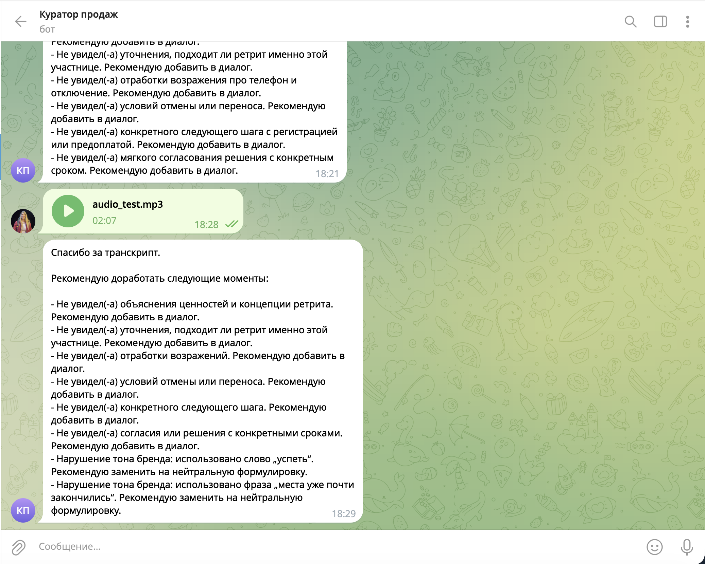

# AI-аудитор продажных звонков ретрита «Познай себя»

Telegram-бот для руководителя отдела продаж. Куратор присылает запись разговора менеджера с потенциальной участницей, бот расшифровывает ее и возвращает короткий разбор: какие этапы разговора пропущены и где менеджер вышел из тона бренда. Демо: [@curator_audit_bot](https://t.me/curator_audit_bot).



## О проекте

Бот сверяет каждый разговор с одним и тем же чек-листом из 11 смысловых блоков, поэтому оценки не зависят от того, кто и в каком настроении слушал запись. Каждая проверка сохраняется в базу, и по истории видно, какие пункты менеджеры пропускают чаще всего.

## Задача

В продажах ретрита менеджер должен провести клиентку по понятной логике: теплый контакт, выявление запроса, рассказ о программе и ценностях, стоимость, работа с сомнениями, следующий шаг. Слушать и разбирать каждый звонок вручную долго, а оценки получаются субъективными и разными у разных проверяющих.

## Решение

1. **Запись в чат.** Куратор отправляет боту аудиофайл или видео со звонком.
2. **Расшифровка.** AssemblyAI переводит речь в текст. Сервис справляется с длинными записями и разговором двух собеседников.
3. **Аудит по чек-листу.** Модель OpenAI получает расшифровку и инструкцию из `prompt.md` и проверяет 11 блоков: приветствие и контакт, выявление потребности, ценности ретрита, программа и формат, подходит ли ретрит этой участнице, результат после ретрита, работа с возражениями, стоимость и условия, следующий шаг, тон без давления, решение клиентки.
4. **Отчет по шаблону.** Сначала пропущенные блоки, потом нарушения тона бренда с точной цитатой из реплики менеджера. Формулировки заданы заранее, поэтому отчеты по разным менеджерам легко сравнивать. Если все 11 блоков закрыты и тон не нарушен, бот пишет: «Отлично проведенный диалог!»
5. **История в базе.** Кто прислал, какой файл, расшифровка, итоговый аудит, успех или ошибка. Все это сохраняется в PostgreSQL.

Чек-лист и правила тона живут в `prompt.md`. Чтобы поменять логику аудита, код трогать не нужно.

**Два языка.** Звонок может быть на русском или английском. AssemblyAI сам определяет язык записи (ждет `ru` или `en`, при сомнении берет русский), и аудит пишется на языке разговора по `prompt.md` или `prompt_en.md`. В английской версии свой список слов давления: "hurry", "discount", "today only", "only N spots left". Служебные сообщения бота идут на языке пользователя: из настроек Telegram, по ссылке `?start=en` или по команде `/language`. Пример английского звонка: `demo/audio_test_en.mp3` (сгенерирован OpenAI TTS).

## Результат

- Качество звонков контролируется без ручного прослушивания.
- Каждый менеджер получает конкретные рекомендации по своему разговору.
- Все менеджеры оцениваются по одному чек-листу, и общение с клиентками становится единообразным.
- История проверок дает данные для управления продажами: какие пункты проседают и как меняется качество со временем.

## Стек технологий

| Технология | Зачем используется |
|---|---|
| **Python** | Язык бота, в контейнере 3.12 |
| **python-telegram-bot** | Прием записей, скачивание файлов, ответы и статусы обработки в чате |
| **AssemblyAI** | Распознавание речи в аудио и видео |
| **OpenAI API** | Аудит расшифровки по чек-листу. Модель задается в `.env`, по умолчанию `gpt-4.1-mini` |
| **prompt.md** | Роль куратора, 11 критериев, правила тона и шаблоны формулировок |
| **PostgreSQL + psycopg2** | История проверок для аналитики |
| **Docker Compose** | Бот и база поднимаются одной командой |

## Структура репозитория

- `bot.py`: бот целиком, от приема файла до записи в базу.
- `prompt.md`: инструкция для модели.
- `demo/`: пример отчета и тестовая запись `audio_test.mp3`.

## Запуск

```bash
cp .env.example .env      # TELEGRAM_BOT_TOKEN, ASSEMBLYAI_API_KEY, OPENAI_API_KEY
docker compose up -d --build
```

Для запуска без Docker нужен свой PostgreSQL, строка подключения задается в `DATABASE_URL`:

```bash
pip install -r requirements.txt
python bot.py
```

Проверить бота можно на записи `demo/audio_test.mp3`.

## Автор

Татьяна Дзюбас, AI-инженер по автоматизации. Делаю Telegram-ботов, RAG-ассистентов и LLM-агентов, которые снимают рутину с небольших команд. Кейсы и контакты на [tatidzufri.com](https://tatidzufri.com).
